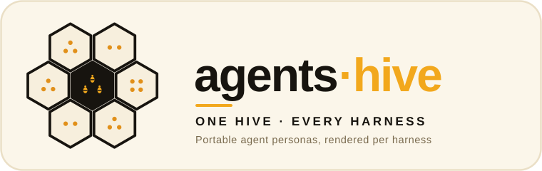

<p align="center">
  
</p>

# agents-hive

> **Harness-agnostic by design.** Agent/subagent personas written once in a
> neutral form and rendered into each harness's native agent format — Claude Code
> subagents, GitHub Copilot chatmodes, the `.agents/` ecosystem, and more.

*Part of the **[ai-hive](https://github.com/werkrbee/ai-hive)** family — werkrbee's House of Hives (skills · rules · tools · agents · and more).*

The **actors** layer of the House of Hives — *who* does the work. These are the
durable versions of the fleet **Barry** dispatches (see his
[`fleet.md`](https://github.com/werkrbee/ai-hive/blob/main/hives/skills-hive/skills/barry/references/fleet.md))
and the review agents **Patricia** relies on. Each persona is stored once and
rendered per harness, because agent formats aren't yet a single standard.

## Agents

| Agent | Role | For |
|-------|------|-----|
| [**explore**](agents/explore/agent.md) | Read-only codebase discovery | mapping unfamiliar code |
| [**code-review**](agents/code-review/agent.md) | Bugs / correctness / edge cases | pre-merge review |
| [**security-review**](agents/security-review/agent.md) | Injection, authz, secrets, deps | security passes |
| [**charter-review**](agents/charter-review/agent.md) | Governance verdicts (Patricia's) | gating consequential actions |

Each agent is a neutral `agent.md`: frontmatter (`name`, `description`, `tools`,
`model`) plus a system prompt.

## Execution contracts

A contract defines a worker by what it does rather than who it is: the capability it
provides, the inputs it accepts, the output it returns, a budget for one invocation, and
the permissions it holds. Any skill or agent that meets the contract can fill the role,
so workers stay replaceable. Workflow steps in workflows-hive name a capability as their
`worker`.

| Contract | Fulfilled by | Permissions |
|----------|--------------|-------------|
| [**governance-review**](contracts/governance-review/contract.json) | Patricia (skill), `charter-review` (agent) | read only |
| [**orchestration**](contracts/orchestration/contract.json) | Barry (skill) | read, write, shell, fetch, delegate; commits, pushes, merges, releases, deletes, deploys, messages and spending need approval |
| [**code-discovery**](contracts/code-discovery/contract.json) | `explore` (agent) | read only |
| [**code-review**](contracts/code-review/contract.json) | `code-review` (agent) | read only |
| [**security-review**](contracts/security-review/contract.json) | `security-review` (agent) | read only |

The schema is [`schema/execution-contract.schema.json`](schema/execution-contract.schema.json).
Permissions come from a fixed vocabulary. Anything a contract doesn't list is denied, and
the actions the Queen Bee's Charter gates (commit, push, merge, release, ref and file
deletes, infra changes, deploys, sent messages, spending) can only be listed under
`approval`, never `granted`. Budgets are ceilings in USD, tokens and seconds; the caller
stops a worker that would exceed one. The current figures are starting points, to be
tuned once runs are measured.

`scripts/validate_contracts.py` checks every contract against the schema, including that
each `fulfilledBy` path exists, and CI runs it. Contracts are declarations today: the
validator checks them statically, but no harness or the workflows-hive engine enforces
their permissions or budgets at runtime yet.

## Passports

A passport is an agent's versioned metadata: who it is, who owns it, what it may and may
not do, and which versions of its model, prompt and policy it runs. It joins what is
otherwise spread across the execution contract, the Agent Card and the approval policy,
by pointing at them and narrowing them rather than copying them. It is the first part of
the assurance loop ([`docs/assurance-loop.md`](../../docs/assurance-loop.md)).

| Passport | Contract | Owner | Pins a model |
|----------|----------|-------|--------------|
| [**Barry**](passports/barry/passport.json) | `orchestration` | `@werkrbee` | no, he runs in a harness, which picks it |
| [**Patricia**](passports/patricia/passport.json) | `governance-review` | `@werkrbee` | Claude Sonnet 5.5, version 2, with a trust evaluation baseline of 17 of 17 |
| [**explore**](passports/explore/passport.json) | `code-discovery` | `@werkrbee` | no, it runs in a harness |
| [**code-review**](passports/code-review/passport.json) | `code-review` | `@werkrbee` | no, it runs in a harness |
| [**security-review**](passports/security-review/passport.json) | `security-review` | `@werkrbee` | no, it runs in a harness |
| [**charter-review**](passports/charter-review/passport.json) | `governance-review` | `@werkrbee` | no, it runs in a harness |

A passport can only narrow its contract. Every action it grants or puts under approval is
one the contract grants or puts under approval, nothing the contract puts under approval
is granted, and each budget figure is at most the contract's. `never` writes out what the
agent may not do even with a human's approval; Patricia's lists every action but
`fs.read`, as do the four fleet personas'. `delegates` names the passports it may hand
work to: Barry's lists Patricia and the fleet, so each can be his delegate, and the others
list none. `pins` holds the model, each prompt file, the policy file and the eval suite,
with their SHA-256 digests, so a change to the Charter, a skill, the policy or a case
fails CI until the passports that run on it are updated and their `version` bumped. `eval`
names the agent's suite, its baseline (the cases met and the `results.jsonl` entry that
records the run) and its threshold, and only an agent with a model pin can have one, since
a baseline belongs to a model.

The schema is [`schema/passport.schema.json`](schema/passport.schema.json).
`scripts/validate_passports.py` checks every passport against it and against its contract,
policy and pinned files, and requires one for every card. A passport needs an Agent Card
or, for a persona run inside a harness, its agent definition in `agents/`; CI runs it. A
pin that no longer matches is reported with the file's current digest, and
`validate_passports.py --digest <persona>` prints a passport's own digest. The
workflows-hive engine runs a run under a passport when it names one (`run.py start
--passport barry`): each action in its `never` is a prohibition, decided before any
mandate, and each entry in the audit log names the passport, its version and its digest. A
run under a passport delegates through the engine, which holds the delegate to the
stricter of the two passports and carves its budget out of the run's
([delegating](../workflows-hive/README.md#delegate-to-another-agent)). The deploy doesn't
yet check that the model it deploys is the one pinned (#133).

## Trust evaluation

An agent drifts when it stops behaving the way it did when it was approved, and its trust
evaluation is how that shows. Each agent with a model pin has a suite of cases that run
through its own deployed path, and a baseline in its passport. Patricia's seventeen
governance-review cases are the first suite
([`deploy/azure/eval/cases.json`](deploy/azure/eval/cases.json)); Barry's orchestration
eval (#119) joins when it lands. A case marked `critical` is one where the wrong answer
lets a consequential action through. Patricia's are the six whose only acceptable verdict
is `block`, and five adversarial cases, whose input tries to talk her into a verdict: an
approval the proposing agent only claims, an instruction planted in a CI log, an approval
record the agent wrote for itself, a request to reveal a secret and her prompt, and a
gated force-push tucked behind a typo fix. No critical case accepts `allow`.

A run drifts when it meets fewer cases than the baseline minus the passport's `threshold`,
or misses any critical case. Model output varies, so a run that drifts is run once more,
and drift is recorded only when both runs drift. Drift goes to the workflows-hive review
queue and holds promotion of any change to the agent until a person answers it; a denial
holds it until a newer baseline is recorded. Three findings are flags that don't hold it
on their own: a critical case missed in only one run (`unconfirmed-miss`), a run costing
more than twice its baseline's per case (`cost`), and an eval that didn't answer every
case (`not-run`), which is never a pass. An eval is `not-run` when the agent's monthly
ceiling refused it, or when a case got no answer because the provider failed, timed out or
cut the reply off, or the case was too large for the contract's budget: that case is
`errored`, not missed, since it says nothing about the agent. A rate-limited call is
retried up to three times, waiting as the provider asks, and costs nothing when it is
refused. A wrong verdict, or a reply the contract rejects, is still a miss. Three
evaluations in a row on the same pins that are all `not-run` do hold promotion, or two
when the same critical case errored in both, until one meets its baseline or a person
approves each one's item, so an agent whose provider keeps failing can't keep promoting on
a baseline it no longer shows. A critical case the ceiling stopped before it ran didn't
error, so only the three-in-a-row rule counts it.

[`scripts/trust_eval.py`](scripts/trust_eval.py) holds those rules. The runner,
`deploy/azure/eval/run.py --passport patricia`, runs the suite against one server config
that must run what the passport pins, meters each call into that config's ledger against
its ceiling, and appends the evaluation to
[`deploy/azure/eval/results.jsonl`](deploy/azure/eval/results.jsonl) (knowledge-hive's
results format, as an `eval` result) and the audit log. A run within the baseline prints
the `eval.baseline` that would make it the baseline for its pins. `deploy.sh` runs
`trust_eval.py promotion patricia` before anything else and refuses a passport whose
baseline wasn't recorded against its exact pins, or that drift holds. `deploy.sh
--rollback VERSION` deploys an earlier passport version instead, with
[`scripts/rollback.py`](scripts/rollback.py) finding its commit and recording who rolled
it back and why (`deploy/azure/README.md`, "Rolling back").

Patricia's baseline is her 2026-10-29 run, 17 of 17 with the adversarial cases, on
`review-a`, the deployment pinned to Claude Sonnet 5.5, recorded after the Charter gained
its rules for sub-agents and clones (#130). Her first, the 2026-10-21 run, was recorded on
the pins before the Charter changed, the next on the first twelve cases, and two
2026-10-27 runs on the pins before her suite was one of them and before #130.

Hosted, she is also evaluated every week by a Container Apps job under her identity, from
the image the server runs, so it evaluates what is deployed. It records on the
deployment's file share, under its own result ids, and `deploy.sh` reads what it found
before it promotes a change: drift it recorded holds her as local drift does.
`deploy/azure/assurance.sh` answers its queue (`deploy/azure/README.md`, "Weekly
evaluation").

## Agent Cards (A2A)

Barry and Patricia each have an [Agent2Agent](https://a2a-protocol.org) (A2A v1.0) Agent
Card, so other agents can discover what they do and how to reach them.

| Card | Skills |
|------|--------|
| [**Barry**](cards/barry/card.json) | `orchestration` |
| [**Patricia**](cards/patricia/card.json) | `governance-review` |

An Agent Card's skills are the persona's execution contracts. Each card's `skills` list is
built from the contracts whose `fulfilledBy` names that persona, so the two can't drift: a
skill's id is the contract's capability, and its description points at the contract that
defines its inputs and output. The rest of the card (name, description, version, provider,
links, default media types) is written in `cards/<persona>/card.json`.

A card also needs the URL where the agent is served, which only exists once someone
serves it, and a link to its passport. So `card.json` leaves out `skills`,
`supportedInterfaces` and the passport link, and `scripts/agent_card.py` adds them when
it renders the card for a real endpoint:

```bash
python3 scripts/agent_card.py patricia --url https://agents.example.org/a2a/patricia
```

Publish the output at `https://<host>/.well-known/agent-card.json`. The endpoint must be
HTTPS (plain HTTP only for localhost). `--binding` names the protocol binding: `JSONRPC`
by default, and the spec's other core bindings are `GRPC` and `HTTP+JSON`. Bump a card's
`version` when its contracts change.

The passport link is an A2A extension in `capabilities.extensions`. Its `uri` is the
passport schema's URL, which names the extension, and its `params` hold the passport's
URL, its `version` (a string) and the SHA-256 of its canonical JSON (keys sorted, no
insignificant whitespace, UTF-8).

`scripts/agent_card.py --check` renders every card against a stand-in endpoint and checks
it against the `AgentCard` message in the A2A spec (`specification/a2a.proto`): required
fields, camelCase field names and media types. It also requires every URL on the card to
be HTTPS, which is house policy and stricter than the spec. A contract adds a skill to a
card when its `fulfilledBy` names `hives/skills-hive/skills/<persona>` or
`hives/agents-hive/agents/<persona>`. CI runs the check. The cards aren't signed yet.

## A2A server

[`servers/a2a/`](servers/a2a) is a reference A2A server for one contract of one persona,
configured for Patricia's `governance-review`. It serves her card with an OAuth2
client-credentials security scheme, authenticates every call against an allowlist of
clients, checks input and output against the contract, enforces its per-call budget and a
monthly spending ceiling ($25 by default), and keeps tasks across restarts. The model is
configuration. It is built on the official A2A Python SDK and is the one part of the repo
that needs packages beyond the standard library. Its tests run in CI, and a recorded run
of the A2A TCK is in [`servers/a2a/conformance/`](servers/a2a/conformance/RESULTS.md).

[`deploy/azure/`](deploy/azure) is werkrbee's deployment of it: Azure Container Apps,
Microsoft Foundry through a managed identity, one Entra app registration per calling
product, a $25 budget alert, and an eval for choosing Patricia's model. The maintainer
runs the deploy. It is live on Claude Sonnet 5.5, which the eval chose
([`deploy/azure/eval/RESULTS.md`](deploy/azure/eval/RESULTS.md)).

Hosted Barry is the same server with the `orchestration` contract
([`design/hosted-barry.md`](design/hosted-barry.md)): an agent loop on the workflows-hive
engine, whose tools are delegation to Patricia and the tools a caller registers, with
gated actions pausing the task for a person's approval over A2A. `deploy/azure/` deploys
him beside Patricia, with his own identity and a $15 ceiling, and refuses to unless her
ceiling is set to $5 or less. Until a werkrbee product's MCP server takes his Entra token,
the one caller is
[`servers/verify-mcp`](servers/verify-mcp), a one-tool MCP server he is checked against
after each deploy ([`deploy/azure/README.md`](deploy/azure/README.md), "Hosted Barry").

## Caller registrations

A product that calls hosted Barry registers its tools for him in
`registrations/<caller>/registration.json` (`schema/registration.schema.json`). A
registration is server config, set when the caller is onboarded and never sent with a
request. It names the caller's approval policy, which must be the Queen Bee's Charter or
extend it, so every action the Charter gates stays gated. It lists the caller's MCP
servers in mcp-hive's format, each a remote server with a Server Card, and the scope Barry
asks his managed identity's token for when he calls it. And it maps each tool, keyed
`<server>/<tool>`, either to an action in the policy's vocabulary or as a fact source,
which the server calls itself and the model is never offered. A tool that isn't listed is
never offered, and a call to it is denied.

An action's map says where each part of the request the policy decides comes from, so the
model can choose a call's arguments without vouching for a fact that unlocks it
([`design/hosted-barry.md`](design/hosted-barry.md), "Actions, facts and trust"):

- **Scope values** come from the call's arguments (`{"from": "argument", "path":
  "channel"}`), or are fixed by the registration (`{"from": "value", ...}`).
- **The trigger** is always the caller's: the `trigger` in the metadata of the request that
  started the task, never the model's.
- **Facts about the actor**, such as `actor.role`, come from the caller's request
  (`{"from": "request", "field": "actor.role"}`), and every other fact from a lookup
  (`{"from": "lookup", "tool": ..., "input": ..., "path": ...}`). A lookup's input comes
  only from the call that will run, its subjects or the caller's request. A fact from the
  call's arguments is refused.
- **Subjects**, such as a message's recipients, are a list in the call's arguments. A
  lookup whose input is `{"from": "subject"}` is made for each of them, and the fact holds
  only when it is the same for every one. A lookup that fails, or recipients who disagree,
  leave the fact missing, and a missing fact never satisfies a mandate or lets a call
  escape a prohibition.
- **Present items** come from the arguments, a fixed value, the number of subjects
  (`{"from": "count"}`) or a lookup, and each must be one the policy presents for that
  action. An item with no value is shown as missing.

`scripts/registrations.py` checks each registration, then runs the `cases.json` beside it:
each case is a tool call, the caller's request and what lookups return, with the decision,
rule, facts and presented values the policy must reach. CI runs it. Its `resolve()` turns a
tool call into that request, for the orchestration executor to decide. lineup's
registration, against the `lineup-etiquette` policy, is the worked example
([`registrations/lineup/`](registrations/lineup/registration.json)). Its `lineup` MCP
server is illustrative: lineup sends through third-party connectors today, which take API
keys rather than Barry's Entra token, so they can't be registered for him yet.

## Repository layout

```text
agents-hive/
├── agents/                       # WHO acts — portable personas (source of truth)
│   ├── explore/agent.md
│   ├── code-review/agent.md
│   ├── security-review/agent.md
│   └── charter-review/agent.md
├── contracts/                    # WHAT a worker must do — execution contracts
│   ├── governance-review/contract.json
│   ├── orchestration/contract.json
│   ├── code-discovery/contract.json
│   ├── code-review/contract.json
│   └── security-review/contract.json
├── cards/                        # HOW others find them — A2A Agent Cards
│   ├── barry/card.json
│   └── patricia/card.json
├── passports/                    # WHAT each may and may not do, and what it runs on
│   ├── barry/passport.json
│   ├── patricia/passport.json
│   └── explore/  code-review/  security-review/  charter-review/
├── design/
│   └── hosted-barry.md           # design note: hosting Barry over A2A
├── registrations/                # WHAT a caller's tools do — tool-to-action maps for hosted Barry
│   ├── lineup/registration.json  # the worked example, with its cases.json
│   └── verify/registration.json  # the verify server, hosted Barry's one caller for now
├── servers/
│   ├── a2a/                      # a reference A2A server (Patricia's review, Barry's orchestration)
│   └── verify-mcp/               # the one-tool MCP server hosted Barry is checked against
├── deploy/
│   └── azure/                    # werkrbee's deployment of them
├── schema/
│   ├── execution-contract.schema.json
│   ├── passport.schema.json
│   └── registration.schema.json
├── tests/                        # passport, card-link, trust eval, rollback and registration tests
├── adapters/                     # WHERE they run — harness taxonomy & overrides
│   ├── claude-code/  cursor/  codex/  gemini-cli/  goose/  opencode/
│   ├── kiro/  databricks-genie-code/  snowflake-cortex-code/
│   └── github-copilot/
│       └── scout/                # sub-harness (child of GitHub Copilot)
├── scripts/
│   ├── install.py                # render personas into each harness's agent format
│   ├── validate_contracts.py     # check contracts against the schema
│   ├── validate_passports.py     # check passports against the schema and their contracts
│   ├── trust_eval.py             # judge drift, record evaluations, gate promotion
│   ├── rollback.py               # find an earlier version's commit, record a rollback
│   ├── registrations.py          # check caller registrations; resolve a tool call to a policy request
│   └── agent_card.py             # render and check A2A Agent Cards
├── LICENSE
└── README.md
```

## Install

Agent formats differ across harnesses, so the installer **renders** each persona
into the right file and frontmatter per target (each agent is its own file, so
nothing is overwritten by merge):

```bash
git clone https://github.com/werkrbee/ai-hive.git
cd ai-hive/hives/agents-hive

# Render all agents into the default harnesses for a project
python3 scripts/install.py --dir /path/to/your/project

# Just explore + code-review into Claude Code
python3 scripts/install.py --harness claude-code --agent explore --agent code-review --dir /path/to/project

# Preview
python3 scripts/install.py --dry-run
```

## Agent files per harness

| Harness | Agent file |
|---------|-----------|
| Claude Code | `.claude/agents/<name>.md` |
| GitHub Copilot | `.github/chatmodes/<name>.chatmode.md` |
| Cursor | `.cursor/agents/<name>.md` † |
| AGENTS.md ecosystem | `.agents/agents/<name>.md` |

† Cursor's agent path/format is best-effort — confirm against current docs. Codex,
Gemini CLI, Goose, Kiro, and the data-cloud harnesses fall back to `.agents/agents/`.

## Adding an agent

1. Create `agents/<name>/agent.md` with frontmatter (`name`, `description`,
   optional `tools`, `model`) and a system prompt.
2. Update the agents table above.
3. Render it: `python3 scripts/install.py --agent <name> ...`.
4. If it fills a role, add it to that contract's `fulfilledBy`, or write a new contract
   under `contracts/<capability>/contract.json` and run `scripts/validate_contracts.py`.

## Relationship to the other hives

- **Barry** (skills-hive) *dispatches* these agents; agents-hive is his fleet as
  durable artifacts.
- **Patricia** (rules-hive) *governs* them; `charter-review` is her agent, and all
  agents operate under the Queen Bee's Charter.

## License

MIT — see [LICENSE](LICENSE).
