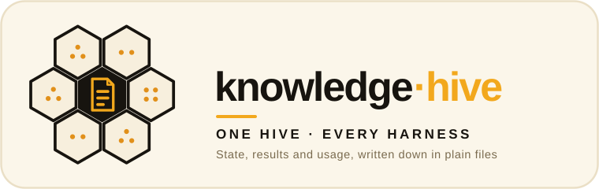

<p align="center">
  
</p>

# knowledge-hive

> **Operational state, written down once.** What a product knows about itself between
> sessions — its current state, what it has done, and what it has spent — in plain files
> every harness can read.

*Part of the **[ai-hive](https://github.com/werkrbee/ai-hive)** family — werkrbee's House of Hives (skills · rules · tools · agents · and more).*

The **state** layer of the House of Hives. Apps built on the House each hand-rolled a
status file, a resume file and some memory, and those files overlapped, drifted and
needed secrets redacted by hand. knowledge-hive standardizes that pattern into three
parts: **persistent state** (a current snapshot plus durable memory entries),
**results** (what was done and checked) and a **usage ledger** (what the work cost). An
**audit log** (what every agent decided and did) sits beside them, hash-chained so it
can't be quietly edited.

[`DESIGN.md`](DESIGN.md) defines where each part lives in a product and the format of
each. [`templates/knowledge/`](templates/knowledge) is a starting point to copy,
[`examples/lineup/knowledge/`](examples/lineup/knowledge) is a worked example, and
`scripts/check_knowledge.py` checks a product's directory against the format.

## The parts

| Part | Where, in a product | What it holds |
|------|---------------------|---------------|
| Persistent state | `knowledge/STATE.md` | Summary, components, references, the one list of open work, how to resume |
| Persistent state | `knowledge/memory/<slug>.md` | One durable fact each: a decision, constraint, preference or reference |
| Results | `knowledge/results.jsonl` | Append-only records of what was done and checked, with evidence |
| Usage ledger | `knowledge/ledger.jsonl` | Append-only cost and token entries, tied to workflows-hive runs |
| Audit log | `knowledge/audit.jsonl` | Append-only, hash-chained entries for every decision an agent's run makes |

Nothing in `knowledge/` holds a secret: references say where a value lives, never the
value.

## Start a product's knowledge

```bash
git clone https://github.com/werkrbee/ai-hive.git
cp -R ai-hive/hives/knowledge-hive/templates/knowledge /path/to/your/product/

# Fill in STATE.md and replace memory/example-decision.md, then check it
python3 ai-hive/hives/knowledge-hive/scripts/check_knowledge.py /path/to/your/product/knowledge
```

Then add a line to the product's `AGENTS.md`: read `knowledge/STATE.md` at the start of a
session, update it before ending one, and append to `results.jsonl` and `ledger.jsonl` as
work is done and checked.

The checker needs Python 3 and nothing else. It checks `STATE.md` (frontmatter, the five
sections in order, the two tables and the numbered lists), every memory entry,
`results.jsonl`, `ledger.jsonl` and `audit.jsonl`'s chain. It also scans every file for
API keys, tokens, private keys, email addresses and phone numbers, which must never be
written there. That scan is a heuristic: it catches the common shapes, not every secret.
The rules it holds you to beyond the format are listed in
[`DESIGN.md`](DESIGN.md#what-the-checker-holds-you-to). With no arguments it checks the
template and the examples, and CI runs it that way.

## The audit log

The workflows-hive engine writes an audit log for every run: each step decision, approval,
denial, escalation, cancel, expiry, budget refusal and model turn, and the passport the
run is under, with each answer from the review queue and how it came. Each entry holds the
hash of the one before it, so an entry that was edited, removed, inserted or moved breaks
the chain. Each run record keeps the seq and hash of its run's last entry, which catches a
log whose end was cut off. The log holds no call arguments, model output or message text,
which stay in the run record, and names a person only by an opaque ID. The format is in
[`DESIGN.md`](DESIGN.md#audit-log-auditjsonl).

```bash
python3 scripts/check_audit.py ~/.local/state/workflows-hive/audit.jsonl \
  --runs ~/.local/state/workflows-hive/runs
```

`check_audit.py` reports the first place the chain breaks and, given the run records, a
log that ends before a run's last entry. The Queen Bee's Charter forbids any agent to
delete, edit, truncate or rewrite an audit log, and its approval policy prohibits
`audit.edit` and `audit.delete`.

What a local log can't stop: an agent that can write the directory holding it can
rewrite the whole log, recompute every hash and change the run records to match. The
approval policy can't tell that write from any other, since its scopes match exact values
and a shell can write files without asking for `fs.write`. So the local log is evidence
of tampering by anyone who didn't rewrite it whole, not a lock. A hosted deployment, where
the agent has no file system or shell and each entry also goes to storage nobody can
rewrite, is the strong case.

## Worked example: lineup

[`examples/lineup/knowledge/`](examples/lineup/knowledge) is lineup's
[`STATUS.md`](https://github.com/werkrbee/lineup/blob/main/STATUS.md) and
[`PROJECT_STATE.md`](https://github.com/werkrbee/lineup/blob/main/PROJECT_STATE.md)
converted to this format, as of the 2026-08-19 snapshot. It is an example, not lineup's
live state. The two files' next steps become one Open work list. The live IDs become
references that say how to look each one up. The connector constraints, the
decisions behind the bullpen and the Inkbox switch, and a pointer to the ACS and WhatsApp
design become seven memory entries, and the tested email channel becomes a result. The member roster stays in Airtable. lineup
recorded no costs, so its ledger is empty; the first entries will come from metered work.

## Repository layout

```text
knowledge-hive/
├── adapters/                     # WHERE it's read — harness taxonomy & overrides
│   ├── claude-code/  cursor/  codex/  gemini-cli/  goose/  opencode/
│   ├── kiro/  databricks-genie-code/  snowflake-cortex-code/
│   └── github-copilot/
│       └── scout/                # sub-harness (child of GitHub Copilot)
├── templates/
│   └── knowledge/                # copy into a product: STATE.md, memory/, results, ledger, audit
├── examples/
│   └── lineup/knowledge/         # lineup's state files, converted
├── scripts/
│   ├── check_knowledge.py        # check a knowledge/ directory against the format
│   └── check_audit.py            # check an audit log's chain and end; the engine's writer
├── tests/                        # the audit log's hash rules and the verifier's reports
├── DESIGN.md                     # the format of each part
├── LICENSE
└── README.md
```

A product's instruction file (`AGENTS.md` or its harness equivalent) points agents at
`knowledge/STATE.md`, so most harnesses need nothing more. The `adapters/` tree holds
per-harness wiring if one ever needs it, such as mirroring memory entries into a
harness's own memory, the same taxonomy every other hive uses.

## Relationship to the other hives

- **workflows-hive** writes a run record per run, and appends every decision to the
  audit log. Its per-step cost is designed to become ledger entries, and a finished run
  can be recorded as a result; the engine doesn't write either yet.
- **agents-hive** execution contracts set per-call budgets. The ledger is where spending
  against them is summed; the hosted Patricia server checks its monthly ceiling against
  its own ledger.
- **rules-hive** keeps the Charter. Its rules to checkpoint long work and to verify before
  calling something done need somewhere to write things down, and this hive is that place.
  Its rule to keep the record whole is what the audit log holds agents to.
- **agents-hive** passports name each agent. The audit log names the passport, version
  and digest each run was under.

## License

MIT — see [LICENSE](LICENSE).
