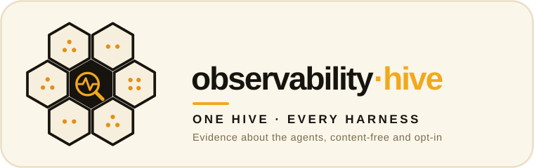

<p align="center">
  
</p>

# observability-hive

> **Evidence about the agents, under one contract.** Which agents run, who owns them, how
> they behave, what risks need attention, what they cost and whether accepted outcomes
> improve, from signals that say how fresh and how complete they are.

*Part of the **[ai-hive](https://github.com/werkrbee/ai-hive)** family — werkrbee's House of Hives (skills · rules · tools · agents · and more).*

The **observability** layer of the House of Hives, opt-in. The House already records most
of what a person needs to know about its agents: passports in agents-hive, run records in
workflows-hive, and the ledger, results and audit log in knowledge-hive. Those records are
kept apart and read only after the fact. This hive defines one signal contract that every
producer and reader uses, so the records can be read together, while a run is going and
across harnesses, model providers and backends.

It owns the signal and privacy contracts, and later the export pipeline and read-only
projections. It owns no record of authority. There is no second agent registry, ledger,
evaluator, policy engine or deployment controller here. Every projection can be rebuilt
from its owners' records. No gate reads a signal, so losing telemetry never weakens an
audit entry, a budget or an approval. The boundary is in
[`docs/observability.md`](../../docs/observability.md).

## The signal contract

[`DESIGN.md`](DESIGN.md) defines a signal: an **event**, a **metric**, a **span** or an
**evaluation** reference. Each signal has:

- its **tenant**;
- its **source**;
- the **conventions** it follows;
- **event time** and **ingest time**;
- a **basis** (measured, estimated or unknown);
- the opaque **correlation IDs** that join it to a passport, a run, a step, an A2A task,
  an approval, a ledger entry or a result.

| File | What it holds |
|------|---------------|
| [`schema/signal.schema.json`](schema/signal.schema.json) | A signal's shape |
| [`schema/conventions.json`](schema/conventions.json) | The pinned standards, every attribute a signal may carry with its class and stability, the names per kind, and the migrations from older conventions |
| [`examples/slice.jsonl`](examples/slice.jsonl) | The first vertical slice as synthetic signals: hosted Barry's run calling Patricia over A2A, in one trace |
| [`examples/old-conventions.jsonl`](examples/old-conventions.jsonl) | Signals written under older conventions, read through their migration |
| [`examples/invalid.json`](examples/invalid.json) | Synthetic signals the checker must refuse, each with its reason |

The standards are pinned:

- **W3C Trace Context** Level 1.
- **OpenTelemetry GenAI semantic conventions** v0.1.0. These are in development, not
  stable, so a newer release comes in only through a reviewed migration.
- **OpenTelemetry core semantic conventions** v1.45.0.

What the conventions don't name is under `io.werkrbee.`.

## Content-free by default

A signal carries none of the following:

- prompts, completions, reasoning, or tool arguments or results;
- message text;
- secrets or credentials;
- raw identities;
- sensitive paths or URLs.

An attribute is kept only if `conventions.json` names it. Content attributes are named
so that they can be refused, and one passes only under a capture exception from a
product's own policy, with a retention. An error keeps its class, never its message.
Incoming `traceparent` is validated, baggage is dropped unless allowed, and every read is
scoped to one tenant.

## Check signals

```bash
# The examples: every valid one passes, every invalid one is refused for its reason
python3 hives/observability-hive/scripts/check_signals.py

# A product's own signals, one JSON object per line
python3 hives/observability-hive/scripts/check_signals.py path/to/signals.jsonl
```

The checker needs Python 3 and nothing else. It also holds the helpers a producer uses at
the trust boundary: `parse_traceparent`, `baggage`, `sanitize` and `error_type`. It holds
the reads that stay inside one tenant too, `join` and `freshness`. CI runs the checker on
the examples, and runs the tests in [`tests/`](tests).

## Emit spans

[`scripts/signals.py`](scripts/signals.py) is the seam producers call. The workflows-hive
engine sends a span per run, step and turn through it, and the A2A server one per task, MCP
call and model call (#144). `from_env()` returns no tracer unless an OTLP endpoint is
configured, so with observability off nothing is sent and nothing more is loaded. Turned
on, a `Tracer` sanitizes each span's attributes before anything is queued, checks the span
against the contract, and hands it to a sink:

- `MemorySink` keeps spans in a list, for tests.
- `OtlpSink` posts them in the OTLP JSON encoding from a background thread, best effort.

Correlation IDs travel as `io.werkrbee.<field>` span attributes, and the tenant as a
resource attribute. A run's trace and span IDs are derived from the tenant and the run's
own IDs, so a resumed run continues its trace, and a step's outgoing `traceparent` names
its span.

```bash
OTEL_EXPORTER_OTLP_TRACES_ENDPOINT=http://localhost:4318/v1/traces OBSERVABILITY_TENANT=local \
  python3 hives/workflows-hive/scripts/run.py start word-count --input path=README.md
```

The endpoint must be https, or http to localhost. A configuration the seam can't honour,
such as a gRPC endpoint or an endpoint in the clear, leaves it off with a warning, and the
producer still starts.

## What comes next

These issues come after the contract and the spans, in the order set in
[`docs/sprints/p2.4.md`](../../docs/sprints/p2.4.md):

- bounded export with a local file sink, retries, sampling and volume budgets, and export
  health (#376);
- projections for ownership and lifecycle, health, performance and quality, security
  warnings, drift and outcomes (#377 to #381);
- backend capability maps (#382), in `backends/<backend>/`;
- the operator's skill (#383) and adoption proof (#384).

With observability off, which is the default, every agent works as before and needs no
new dependency.

## Repository layout

```text
observability-hive/
├── DESIGN.md      # the signal contract, the trust boundary, privacy and threats
├── schema/        # signal.schema.json and conventions.json
├── scripts/       # check_signals.py: the checker and boundary helpers; signals.py: the emit seam (stdlib)
├── examples/      # synthetic signals, valid, old and invalid
├── tests/
└── assets/
```

`adapters/` in the other hives is the harness axis: where an artifact runs. This hive has
nothing that differs by harness, so it has no `adapters/`. Its backend mappings will go in
`backends/<backend>/`, so that they aren't confused with harnesses.

## License

MIT — see [LICENSE](LICENSE).
