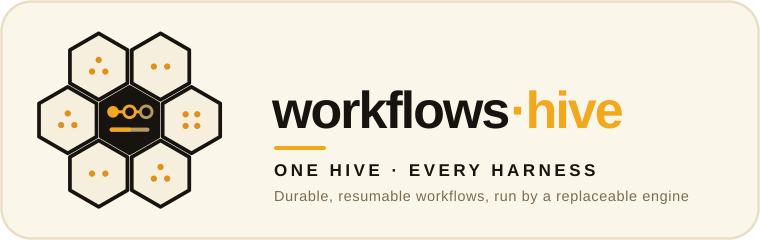

<p align="center">
  
</p>

# workflows-hive

> **Durable, resumable workflows.** Multi-step recipes written once as portable plans,
> run by a replaceable engine, and exposed to every harness through MCP Tasks.

*Part of the **[ai-hive](https://github.com/werkrbee/ai-hive)** family — werkrbee's House of Hives (skills · rules · tools · agents · and more).*

The **orchestration** layer of the House of Hives. Barry decomposes and coordinates work
at runtime; workflows-hive is the saved version of that work. A workflow is a plan of
steps that checkpoints as it runs, so it can survive a restart, pause for approval, and
report its result and its cost when it finishes.

[`DESIGN.md`](DESIGN.md) records the contract: MCP Tasks as the interface, the engine
decision (Temporal evaluated), and the shape of the persisted plan and checkpoint. The
reference engine, `scripts/run.py`, runs plans against it. The MCP Tasks server comes
later.

## Workflows

| Workflow | What it does |
|----------|--------------|
| [**word-count**](workflows/word-count/workflow.json) | Read a text file, then count its words and lines (the resumable spike) |
| [**approved-word-count**](workflows/approved-word-count/workflow.json) | The same, with the count waiting for a human's approval |
| [**budgeted-word-count**](workflows/budgeted-word-count/workflow.json) | The same, with each step held to a budget |

## Repository layout

```text
workflows-hive/
├── workflows/                    # WHAT workflows exist — portable plans
│   ├── word-count/workflow.json
│   ├── approved-word-count/workflow.json
│   └── budgeted-word-count/workflow.json
├── adapters/                     # WHERE they run — harness taxonomy & overrides
│   ├── claude-code/  cursor/  codex/  gemini-cli/  goose/  opencode/
│   ├── kiro/  databricks-genie-code/  snowflake-cortex-code/
│   └── github-copilot/
│       └── scout/                # sub-harness (child of GitHub Copilot)
├── scripts/
│   ├── run.py                    # reference engine: run, checkpoint, resume, approve, budget, cancel
│   ├── review_queue.py           # the human review queue: list, show and answer
│   └── queue_mcp.py              # the review queue as an MCP server, answered by elicitation
├── tests/
│   ├── read-only-policy/         # a test approval policy for the engine's checks
│   ├── test_engine.py            # tests of the engine as a library
│   └── test_queue.py             # tests of the review queue, its command and its MCP server
├── DESIGN.md                     # the workflow contract and engine decision
├── LICENSE
└── README.md
```

A workflow reaches a harness as an MCP server, so most harnesses need nothing beyond
their usual MCP config. The `adapters/` tree holds per-harness wiring if a harness ever
needs it, the same taxonomy every other hive uses.

## Run a workflow

The reference engine needs Python 3 and nothing else. It writes one run record per run to
`~/.local/state/workflows-hive/runs` (change it with `--state-dir`), after every step.

```bash
git clone https://github.com/werkrbee/ai-hive.git
cd ai-hive/hives/workflows-hive

# Run both steps
python3 scripts/run.py start word-count --input path=README.md

# Stop the process right after step 1 checkpoints, then pick the run back up
python3 scripts/run.py start word-count --input path=README.md --crash-after read
python3 scripts/run.py resume <run-id>     # skips step 1, runs step 2

python3 scripts/run.py status <run-id>
```

`--crash-after` exits right after a step's checkpoint is written, to stand in for a
crash or a deploy. A process killed in the middle of a step resumes by running that step
again with the same idempotency key. Every run ends by printing its result and its
cost. The demo workers don't call a model, so they meter an estimated token count at a
simulated price.

A step marked `approval: true` pauses the run before it, in `input_required`, and nothing
runs it until a person answers, usually through the [review queue](#the-review-queue).
`approve` continues the run from that step; `deny` fails the run, with the reason as its
error, and the step never runs. The record keeps who answered, when and how. Who is an
actor ID: `--by`, or `WORKFLOWS_HIVE_ACTOR` when `--by` is left out. Use an opaque one.
The engine refuses an answer or a cancel without one, and one with a space or the shape of
an email address, but it can't tell a name from an ID. `resume` never answers for you: a
run restarted while paused stays paused.

```bash
export WORKFLOWS_HIVE_ACTOR=usr_7f3a                                      # your opaque ID
python3 scripts/run.py start approved-word-count --input path=README.md   # pauses before count
python3 scripts/run.py approve <run-id>                                   # runs count, finishes
python3 scripts/run.py deny <run-id> --reason "not this file"             # or fails the run
```

`approve` and `deny` answer only at an interactive terminal, as the review queue does.
`--id`, which is optional here, names the approval ID being answered, which the pause
prints and `status` shows, and an answer whose ID isn't what the run is waiting on is
refused. Without it, the answer is for whatever the run is waiting on, and the record
still keeps that ID. `review_queue.py` always names the ID.

`cancel` ends a run. A paused run is cancelled at once; a working one stops before its
next step, in whichever process is running it, or when it's resumed. A cancelled run keeps
who cancelled it as its error.

```bash
python3 scripts/run.py cancel <run-id> --by you
```

The commands exit 0 when the run completed, 2 when it's waiting for approval, and 1
otherwise.

A step's `budget` caps what it may spend, in `usd`, `tokens` and `seconds`, each
optional, and the engine passes it to the worker as its cap. A step that runs past its
`seconds` is stopped. A step that reports more `usd` or `tokens` than its cap fails the
run with the reason, and what it spent is still recorded and counted in the run's cost.
When the worker's capability has an execution contract in agents-hive, a step budget
above the contract's per-call budget is refused before the run starts. `--workflows-dir`
and `--contracts-dir` point the engine at other plans and contracts.

```bash
python3 scripts/run.py start budgeted-word-count --input path=README.md
```

A step can list the `actions` it takes, and rules-hive's
[approval policy](../rules-hive/README.md#approval-policy) decides each one just before
the step runs. A prohibited action fails the run without running the step, even after
approval. An action an open mandate allows runs on its own. One a closed mandate gates
pauses the run, and `pending` shows the mandates and what the approval request must
present. An action no mandate allows is denied. `approval: true` still forces a pause,
and `approval: false` can't skip one the policy requires. The policy is the Charter's
unless `start --policy` names a product policy in this repo, and the run keeps it.
Facts compare strictly, and an `--input` value is a string, so a fact that must be
`true` comes from the plan or an earlier step's output.

```json
{ "id": "notify", "worker": "send-message", "input": { "text": "${steps.draft.output}" },
  "actions": [{ "action": "message.send",
                "scope": { "channel": "sms", "audience": "group" },
                "facts": { "recipient.notifyOptIn": true } }] }
```

```bash
python3 scripts/run.py start <workflow> --policy ../rules-hive/examples/lineup-etiquette/policy.json
```

`start --passport <name>` runs the run under an agent's passport from agents-hive
(`passports/<name>/passport.json`), which the engine checks against its contract and pins
before the run starts. Each action in the passport's `never` is a prohibition, decided
before any mandate, so neither the policy nor an approval can open it. The run keeps the
passport's version and digest, and a run whose passport has changed since it started is
refused rather than resumed under the new one.

```bash
python3 scripts/run.py start <workflow> --passport patricia   # an fs.write step fails the run
```

## Roll a run back

A person can roll a completed or failed run back to an earlier step, and the engine does
it without erasing anything. Each later step that took an action with an effect outside
the system, anything but `fs.read`, is undone first by the `compensate` step its plan
declares, newest first. A compensating step is an ordinary step, decided by the policy
like any other, so correcting a message that needed approval waits for approval too. Then
each later step that ran is marked `rolledBack`, kept with its output, and the run waits
at the step after the target. `resume` runs those steps again, each as a new attempt with
a new idempotency key, keeping the earlier attempt in its history.

```json
{ "id": "notify", "worker": "send-message", "input": { "text": "${steps.draft.output}" },
  "actions": [{ "action": "message.send" }],
  "compensate": { "worker": "send-correction",
                  "input": { "message": "${steps.notify.output.id}" },
                  "actions": [{ "action": "message.send" }] } }
```

```bash
python3 scripts/run.py rollback <run-id> --to draft --reason "sent to the wrong group"
python3 scripts/run.py resume <run-id>
```

A rollback past a step with an effect and no `compensate` is refused, since a sent message
can't be unsent, only corrected. A step that lists no actions is taken to have none. The
run's cost isn't reduced: what was spent stays spent. Like an answer, a rollback needs an
actor ID and an interactive terminal, and is refused from inside a run. Its reason stays
in the run record, under `rollbacks`; the audit log's `rollback` entry has who did it and
the digest of that record. Model turns in an open run aren't rolled back.

## The review queue

The review queue is one place where a person sees and answers everything that needs them,
across every run and agent. It holds three kinds of item: an `approval` (a step a run
paused on), an `escalation` (a question an agent's run asked a person) and `drift` (what
an agent's trust evaluation found: the agent below its baseline, or a flag for a person to
look at, which its `finding` names). Each is a JSON file in `queue/` beside the state
directory, with what a person must see to answer it: for an approval, the gated actions,
the mandates that gate them and the values they must present. The run record stays the
source of truth, so answering an approval answers its run.

```bash
python3 scripts/review_queue.py list                 # what is waiting, across every run
python3 scripts/review_queue.py show <id>            # one item, with everything it presents
python3 scripts/review_queue.py approve <id>         # the step runs; for drift, promotion may go ahead
python3 scripts/review_queue.py deny <id> --reason "wrong group"
python3 scripts/review_queue.py answer <id> --text "use the staging repo"   # an escalation
```

An item's ID is a digest. For an approval it is the one hosted Barry's approvals use: the
run, the step, the exact call, its gated actions, the mandates that gate them and the
values shown. So an answer answers only what was shown. If anything the digest covers has
changed by the time the step runs, the approval is void and the step waits again. An
approval or an escalation unanswered for seven days expires, which fails its run. Drift
doesn't expire: when its finding is `drift`, it holds promotion of the agent until a
person answers it, and a denial holds it until a newer baseline is recorded (agents-hive's
`scripts/trust_eval.py`). Every answer, and every expiry, is written to the audit log
before the run moves on, with how the answer came: `via` is `cli`, `mcp` or `a2a`.

An agent must never answer its own queue. So `review_queue.py` refuses to answer when it
isn't attached to an interactive terminal, which harness shells usually aren't, and when
it runs inside an engine run, which the engine marks in each step's and turn's environment
(`WORKFLOWS_HIVE_RUN`); the engine itself refuses an answer from inside a run, whatever
calls it. The Charter's policy also prohibits the action `queue.answer`, so no mandate or
approval can grant a step that declares it. None of this is a lock. On one machine, an
agent with a shell can still forge an answer, as it can rewrite the audit log, so the
local trail is evidence rather than proof. Hosting will be the strong case: once hosted
Barry ships (#120), a queue item there will be the A2A approval request he returns,
answered by the product as its person's attestation, and the agent will have no shell to
reach the queue with.

`scripts/queue_mcp.py` serves the same queue over MCP (stdio), with `list_items`,
`show_item` and each open item as a resource. Its answering tool, `answer_item`, takes
only an item's ID: it asks the person through an MCP elicitation, which their client shows
to them, and records their reply, never a decision from the tool's arguments. A client
without elicitation gets the queue read-only. It answers as the `WORKFLOWS_HIVE_ACTOR` set
in its environment. A client that fills in elicitations without showing them to a person
defeats the point, so add it only to a client that asks you.

```json
{ "mcpServers": { "review-queue": {
    "command": "python3", "args": ["hives/workflows-hive/scripts/queue_mcp.py"],
    "env": { "WORKFLOWS_HIVE_ACTOR": "usr_7f3a" } } } }
```

## The audit log

Every run appends to an audit log in knowledge-hive's [`audit.jsonl`
format](../knowledge-hive/DESIGN.md#audit-log-auditjsonl), by default `audit.jsonl` beside
the state directory (change it with `--audit`). The engine writes an entry for each step
decision (one per action, with the rules that decided it), each step that runs, fails or
is stopped by its budget, each answer, escalation, cancel, expiry, rollback, delegation
and model turn, and each run's start and end. Each entry names the run's passport and the
digest of the exact call, not the call's arguments, which stay in the run record. Entries
are hash-chained, and the engine writes each one before the run record that follows it;
the record keeps the seq and hash of its run's last entry under `audit`. If the log can't
be written, the run doesn't go on.

```bash
python3 ../knowledge-hive/scripts/check_audit.py ~/.local/state/workflows-hive/audit.jsonl \
  --runs ~/.local/state/workflows-hive/runs
```

## Use the engine as a library

`run.py` is also a module. `Engine` offers the commands above (`start`, `resume`,
`approve`, `deny`, `cancel`, `rollback`, and the queue's `items`, `item` and
`answer_item`) on your own workers, with `audit`, `queue` and `actor` in place of
`--audit`, the queue directory and `WORKFLOWS_HIVE_ACTOR`, and an open run for an agent
loop, whose steps aren't known in advance. An open run starts with no steps. Each tool
call the loop makes is appended as a step, and `execute` runs it, decided by the policy,
held to its budget and checkpointed like a planned step. Each model turn goes through
`turn`, which records the reply and its cost, and returns the recorded reply instead of
calling again once the turn has completed. So a loop restarted after a crash replays its
turns and steps from the record and repeats neither. `finish` completes the run with its
result.

```python
import sys
sys.path.insert(0, "hives/workflows-hive/scripts")
import run

engine = run.Engine(workers={"send": send_message},      # send(input, key, cap) -> (output, cost)
                    actor="usr_7f3a")
r = engine.open("orchestration", {"goal": "move tonight's game"}, passport="barry",
                policy="hives/rules-hive/examples/lineup-etiquette/policy.json")
reply = engine.turn(r, "t1", call_model)                  # call_model(key) -> (reply, cost)
engine.append(r, {"id": "t1.send", "worker": "send", "input": {...}, "actions": [...]})
r = engine.execute(r)                                     # working, input_required, failed or cancelled
engine.finish(r, result)
```

A turn whose process died before its reply was recorded is called again, as a step that
died mid-flight runs again with the same idempotency key. A turn that raises fails the
run, and `turn` raises `Stopped` once the run has failed or been cancelled.

`escalate(r, "which-repo", "Which repo should I release?")` asks a person, as the Charter
requires on an ambiguous decision, missing credentials or repeated failure. The run waits
in `input_required` with an escalation in the review queue, and `escalate` returns `None`.
Once a person has answered, the same call returns their answer, so a resumed loop asks
each question once. `drift(agent, result, present, finding)` puts what a trust evaluation
found in the queue: `drift`, or one of the flags `unconfirmed-miss`, `cost` and `not-run`.

## Delegate to another agent

An open run under a passport hands work to another agent with `delegate`, which keeps the
delegate inside the bounds the Charter sets for sub-agents and clones.

```python
child = engine.delegate(r, "map", "explore", ["Find where approvals are answered."])
engine.turn(child, "t1", call_model)                     # the delegate's own loop
engine.finish(child, notes)
```

The delegation is a step of the delegator's run, taking the action `agent.delegate` with
the delegate's passport as its scope, so the policy decides it like any step's action. The
Charter's policy denies it when the delegator's passport doesn't list the delegate in
`delegates`, a fact the engine reads from the passport, never from the request. It also
denies it when `whole_context=True`: the context is the list of items passed, never the
whole conversation. A clone that inherits the whole context isn't delegated at all; it is
the delegator, so it takes its steps and turns in the delegator's run, and `delegate`
refuses the run's own passport. A denial fails the run and raises `Stopped`, and a
delegation the policy gates waits for approval in the queue, returning `None` until it is
approved.

Once allowed, the step starts the delegate's own open run. Its grant is the delegator's
narrowed by the delegate's passport: each action takes the stricter treatment, in the
order never, then approval, then granted, and an action either leaves out is prohibited.
An action under approval in the grant waits for a person even where the Charter would let
it run. Its budget is the delegate's passport's, cut to what the delegator has left, which
is the delegator's budget less what it has spent, what each open delegate holds in reserve
and what each ended one spent. A delegate that spends past its `usd` or `tokens` fails,
and a delegation with nothing left to carve fails its delegator's run. The audit log's
`delegation` entry names both passports, the digest of the grant and the digest of each
item passed, not the items, which stay in the run records. Calling `delegate` again with
the same step returns the same run.

A delegate's run is the delegator's to drive, and cancelling the delegator doesn't cancel
it. A delegation counts as an effect for a rollback, so a run can't be rolled back past
one. A delegate's `seconds` isn't drawn from a pool the delegator shares: it is the lower
of the two passports' limits, and it is recorded in the delegate's budget but not yet
enforced, so only each step's own `seconds` stops a slow delegate. The grant binds only a
delegate: a run started under a passport is held to that passport's `never` and nothing
more, so an action outside its `granted` and `approval` is still decided by the policy
alone. And `context.whole` is the caller's word: the engine can't tell when a list of
items amounts to the whole conversation.

## License

MIT — see [LICENSE](LICENSE).
